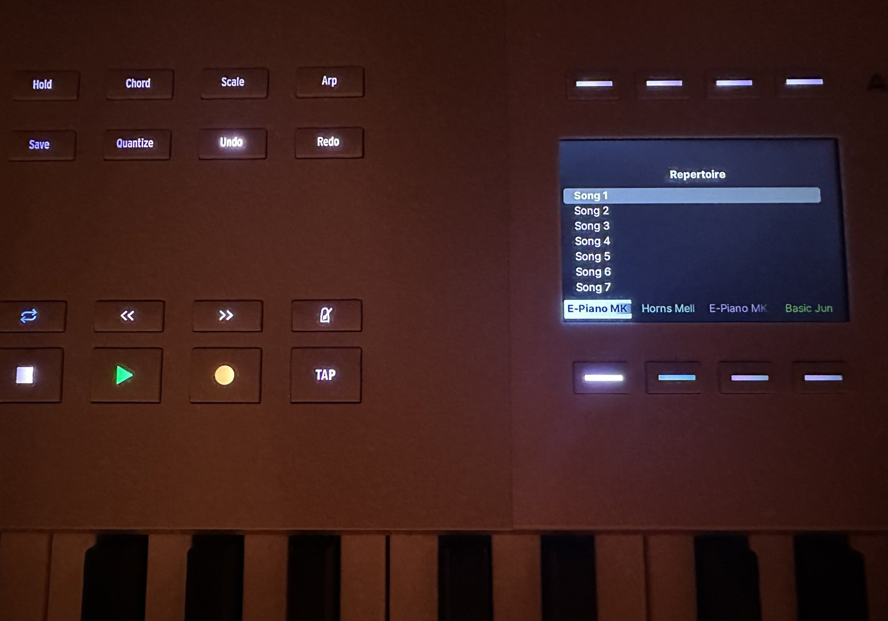
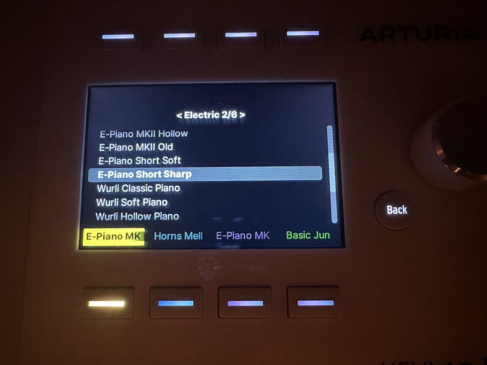
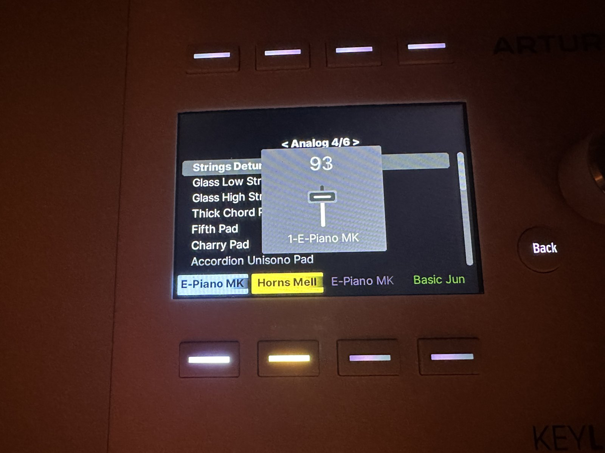

# KeyLabLive

An Ableton Live control surface script (MIDI remote script) for the Arturia
KeyLab 61 and 88 mk3, built for playing live rather than for producing.

Up to eight instrument tracks sharing one preset list on the keyboard's screen,
your Arrangement locators as a song list, and no Max for Live anywhere.

<p>
  
  
  
</p>

*Left: the song list, with a track on each screen button. Middle: a track's
preset list, open on the chapter "Electric" — its button turns yellow while the
list is on screen. Right: touching a fader shows its track's volume.*

Why it works the way it does, and what building it taught about Live and the
KeyLab, is in **[MANIFESTO.md](MANIFESTO.md)**. Working with an AI assistant?
Point it at **[AGENTS.md](AGENTS.md)**.

- **The screen buttons** arm and un-arm your tracks — always, including while a
  preset list is open. Tracks 1-4 are on buttons 1-4, tracks 5-8 on buttons
  5-8. The label is the track's name — or, once you have chosen one, the preset
  it is playing.
- **Hold a screen button** to open the preset list for that track. Pick with the
  jog wheel, **Play** or **Back/Forward**; **Stop** closes the list
  without picking. That button turns **yellow** for as long as its list is on
  screen — hold a *different* button and the list, and the yellow, move to that
  track.
- **The middle of the screen** lists your Arrangement locators, and follows as
  you add, rename, move or delete them. The jog wheel moves the cursor,
  **Play** jumps to that song and starts it, **Stop** stops.
- **Playback stops automatically** just before the next locator, and the cursor
  moves on, ready for the next song.
- **The faders** set track volume, one fader per track.
- **Cycle** rebuilds the preset list from your Collection.
- **Tap and Metro** are tap tempo and the metronome. While a preset list is
  open they step between chapters instead, once you have sorted your presets
  into any.
- **Record, Save, Undo, Redo and Quantize** do what they do in Live — see **The other
  buttons** below.
- **The pads** are dark and do nothing, unless you switch on clip launch — see
  **Clip launch** below.
- **The encoders** are not used. The script does not touch them.

**Know this before you build a set around it:** choosing a preset reloads the
instrument. Held notes are cut, and a large sampled instrument takes as long to
load as it takes. That is inherent to preset files, not a shortcoming of the
script, and it cannot be coded away. Change presets between songs or between
sections — not in the middle of a phrase. Two heavy sounds that have to
alternate *within* one song still belong on two separate tracks.

Requires nothing but Live. No Max for Live licence, no companion devices, no
other software.

Tested on a KeyLab 61 and 88 mk3 with Live 12 on macOS. The SysEx is identical
on both sizes; only the MIDI port name differs. Live 11 is untested and runs a
different Python version.

---

## What you get

```
KeyLabLive.als           a ready-made Live set: four tracks, seven locators
KeyLabLive/              the script — this folder goes into Remote Scripts
  __init__.py
  keylab_config.py       every setting you are meant to change
  keylab_live.py         the control surface
  keylab_presets.py      the preset list and hot-swapping
  keylab_repertoire.py   the song list
  keylab_session.py      clip launch on the pads, off until you switch it on
  keylab_screen.py       the keyboard's protocol — do not edit
  presets.txt            rebuilt from your Collection on every Cycle
  presets-manual.txt     your own list — the script never writes to it
extras/
  fakelive/              run and test the script without Live or the keyboard
  aaCQ20B/               a bridge to an Allen & Heath CQ20B mixer, for builders
MANIFESTO.md             how the rig behind this is built, and what it taught
AGENTS.md                the same, condensed for AI coding assistants
LICENSE                  MIT — use it, change it, pass it on
```

**`keylab_config.py` is the only file you need to open.** It holds the track
limit, the Collection name, the colours and the timings, each with a comment
saying what it does.

`keylab_screen.py` is the opposite: not settings but measured facts about the
hardware — SysEx layouts, CC numbers, LED ids. Changing something there does
not reconfigure anything, it stops the screen working. It is documented so you
can *read* it, not so you can tune it.

---

# Setting up

Six steps, in the order you will actually do them. One of them cannot move: the
script folder must be in place **before** Live starts, or it will not be in the
dropdown to choose.

*`KeyLabLive.als`, next to the script folder, is a set with the tracks and
locators already there: open that and skip to step 2. It was saved in Live 12.4
Suite and needs Live 12.4 or newer to open.*

## 1. Build the Live set

One MIDI track for each instrument you want under your fingers, each with one
instrument on it. Any instrument — it gets replaced the moment you pick a
preset. The script works by track **position**, not by name: it takes the first
tracks in the set, up to eight, one per screen button. Add or remove a track
later and the buttons, the faders and the labels follow without a restart.

That is worth saying plainly: **a track here is a slot, not an instrument.** It
becomes whatever preset you load into it. Nothing in the script cares what a
track is called, which is just as well, because Live renames an un-renamed
track after whatever device it now holds.

Then add **locators** in the Arrangement, one at the start of each song. Their
names become the song list. There is no separate file to maintain.

Save the set. Nothing is stored inside it, but you want it on disk before you
start restarting Live around it.

## 2. Install the script

Copy the `KeyLabLive` folder — the one next to this README, with the `.py`
files in it — into:

| Platform | Folder |
|---|---|
| macOS | `~/Music/Ableton/User Library/Remote Scripts/` |
| Windows | `Documents\Ableton\User Library\Remote Scripts\` |

The folder name is what appears in Live's dropdown, so if you rename it, that
is the name you will be looking for.

## 3. Restart Live

Live scans the Remote Scripts folder once, at startup. A script copied in while
Live is running is not there as far as Live is concerned.

## 4. Choose the control surface

**Preferences → Link, Tempo & MIDI.** In the Control Surface table, pick an
empty row:

| Setting | Value |
|---|---|
| Control Surface | `KeyLabLive` |
| Input | KeyLab mk3 **(DAW)** |
| Output | KeyLab mk3 **(DAW)** |

There are two ports per keyboard. The plain one carries the keys; the **DAW**
one carries the screen, the transport buttons and the jog wheel. Their names
differ by only a few characters — pick the DAW port in both dropdowns.

**Set Arturia's own control surface to None** in any other row that mentions
the KeyLab. It writes track names to the same buttons this script writes
to, and it sends a disconnect when you switch it off. Leave both enabled and
they fight over the screen; you will see a mix of the two and conclude your own
setup works when it does not.

## 5. Put the keyboard in DAW mode

**This is the step that decides whether anything appears on the screen at all.**

The keyboard has two independent worlds: Arturia mode (what Analog Lab uses)
and DAW mode. They use different SysEx families and different CC numbers, and
packets from one are ignored while the other is displayed. This script speaks
DAW mode only.

Switch with the physical keys: **Prog + screen button 6**. (Prog + screen
button 5 goes back.)

There is no SysEx that changes the mode. The script does send a connect
handshake at startup, but that only works when the unit is already in DAW mode.
It is a handshake, not a mode switch.

How to tell you are in DAW mode: the screen buttons send CC 45-52. In Arturia
mode the same buttons send CC 56-63.

By now the screen buttons should carry your track names and the middle of
the screen your locators. If not, go to **When something does not work**.

## 6. Tag a preset or two, then press Cycle

Live's **Collections** are the coloured labels at the top of the browser
sidebar. This script uses **one** of them, for all your tracks together.

1. Right-click any one Collection and rename it **Presets**. Which colour it
   happens to be does not matter — the script looks it up by name. (Prefer a
   different name? Change `PRESET_COLLECTION` in `keylab_config.py`.)
2. Find a preset in the browser and tag it with that Collection. Right-click →
   the Collection's name, or select the preset and press the Collection's
   number — the number is much faster when you are tagging a row of them.

Then press **Cycle**, the button left of Play. It rebuilds the browser index,
writes `presets.txt` from the Collection, and reloads it. The button goes amber
while it works and flashes blue when it is done. Your first Cycle replaces
whatever `presets.txt` arrived in the folder.

Now hold a screen button: the list is there.

---

## Your preset lists

The list on screen is built from two files, which do the same job from opposite
ends. Keeping them apart is what makes both of them safe.

| | `presets-manual.txt` | `presets.txt` |
|---|---|---|
| Who writes it | you, only ever you | the script, on every Cycle |
| Where it looks a preset up | the browser at large | your Collection |
| Tagging needed | no | yes |
| On screen | first | after the manual list |

**`presets-manual.txt` needs nothing set up.** It ships with a starting list of
197 presets in five chapters, so the script has something to show the first time
you open it. Not every chapter exists in every edition of Live: Drift is in all
of them, Analog and Electric need Standard or Suite, and Operator needs Suite. Those presets were picked to demonstrate what the system does, not
because they are the best sounds in Live — delete the lines you do not play.

**The Collection is for what you tag in and out as you work**, which is where
most of your list will come from once you are past the first evening.

One list for every track is deliberate. A track becomes whatever you load into
it, so a preset does not belong to a particular track and there is nothing to
divide up — and your other six Collections stay yours. A Collection holds a
*reference*, not a copy: your presets stay where they are, and the index stays
a dozen entries long instead of thirty thousand, which is why Cycle answers
instantly.

Anything Live's own hot-swap accepts in an instrument slot works: Live's
instruments, Instrument Racks, Sounds, Packs and plugin presets.

### The line format

One line per preset, in both files: the preset's name in Live's browser, then
optionally a comma and a chapter. Leave the name alone — it is how the preset is
found. The chapter is yours.

### How the two files become one list

An example. Two files, as they might stand after a few weeks:

```
presets-manual.txt                 presets.txt
------------------                 -----------
Grand Piano, Racks                 Wurli Classic Piano, Electric
E-Piano Roads, Racks               E-Piano Roads
Bloom Pad                          Warm Pad, Pads

                                   #~ Saw Lead, Leads
```

What the screen shows, one chapter at a time (Tap and Metro step between them):

```
< Racks 1/5 >        Grand Piano, E-Piano Roads
< Other 2/5 >        Bloom Pad
< Electric 3/5 >     Wurli Classic Piano
< Collection 4/5 >   E-Piano Roads
< Pads 5/5 >         Warm Pad
```

The rules that produce it:

- **The manual file comes first**, then `presets.txt`.
- **Chapters appear in the order they first appear**, reading both files in
  that order. Reorder the lines and the order sticks.
- **A preset with no chapter goes into a chapter named after its file**:
  `Other` for a hand-written line, `Collection` for a tagged one.
- **A preset appears at most once per chapter.** `E-Piano Roads` is in both
  files under different chapters — `Racks` in the manual file, `Collection` in
  `presets.txt`, where it has no chapter of its own — so it is shown in each. In both files under the same chapter
  it would be shown once, from the manual file.
- **A `#~` line is not on the list.** It is a preset you tagged once and have
  untagged since — see below.
- **With no chapters anywhere**, there are no chapters at all: one flat list,
  and a preset is shown once.

Presets newly tagged land at the end of `presets.txt` with no chapter, so the
order you know never shuffles under your fingers.

### Untagging does not throw your work away

The line moves to a block at the bottom of `presets.txt` marked `#~`:

```
# ---------------------------------------------------------------
# Remembered: tagged once, not tagged now. These are not in the
# list. Tag one again and it returns above with its chapter. Delete
# a line to forget it for good.
# ---------------------------------------------------------------
#~ E-Piano Roads, Racks
```

It is not in the list and not on screen — untagged means gone. But
tag it again and it comes straight back with its chapter intact. Delete the
line yourself to forget it for good.

That also means you can write a list of chapters *before* you have tagged
anything. Presets you have not got round to tagging sit in the remembered block
and climb back up one by one as you tag them, instead of being wiped at the
next Cycle. A preset that is never going to be tagged belongs in
`presets-manual.txt` instead, where it is on the list straight away.

---

## Chapters

A preset file with forty entries is fine at home and miserable between two
songs. Chapters cut it into lists you can cross in a few clicks.

Put a chapter name after any preset and it appears. **Give no preset a chapter
and there are no chapters at all** — one flat list, exactly as if the feature
did not exist, and Tap and Metro go nearly dark while a list is open. This is
the normal state for anyone who has never opened the file.

- **Tap** is the previous chapter, **Metro** the next — while a preset list is
  open, and only then. They light blue when there are chapters to move between.
  With no list open they are tap tempo and the metronome, as printed.
- **Two things say the chapter buttons are there**, because nothing is printed
  on the keyboard to tell you: the list's title reads `< Racks 2/4 >`, where
  the arrows point at Tap and Metro at the two ends of the transport row and
  the count says whether pressing one is worth it — and when a list opens, both
  buttons blink three times, which touching either one cuts short.
- Past the last chapter is the first again. Set `CHAPTER_WRAP = False` if you
  would rather the ends were ends.
- **Chapters appear in the order they first appear in the file.** There is no
  separate list of them to keep tidy.
- **A preset with no chapter takes the name of the file it came from**, so the
  title on screen says where it came from: `Collection` for one you tagged,
  `Other` for a hand-written line you left blank. Newly tagged presets arrive
  with no chapter, so they gather under `Collection` until you sort them — tag
  first, sort later.
- **Each chapter remembers where you left its cursor**, and each track
  remembers which chapter it was last looking at. Open a list and you are where
  you were. After Live restarts, a track's chapter comes back from whichever
  preset is actually sitting on it; nothing is stored in the set.
- A chapter change loads nothing. It is navigation, not a choice — which is why
  Back and Forward kept their job of stepping the cursor and loading what they
  land on after a short pause, so you can step past two or three presets and
  hear the one you stop at. Handing them to chapters would have cost you the
  only way to audition.

`CHAPTER_TITLE_ARROWS`, `CHAPTER_PULSES`, `CHAPTER_PULSE_SECONDS`,
`CHAPTER_TAGGED` and `CHAPTER_UNNAMED` in `keylab_config.py` turn each of these
down, off, or into your own words.

---

## Day to day

**Press Cycle after tagging a preset, or after editing either preset file.**
Both files and the index are read once at startup. Nothing else needs Live
restarted.

**Put what you reach for during a song near the top of its chapter.** The
list is crossed with the jog wheel or Back/Forward, one line at a time, so the
top of a chapter is the short walk.

**You can see which list you are driving without reading the screen.** The
locator list is what stands there; the preset list only exists while you have
opened it, and the screen falls back to the locators by itself once you have
chosen. While a preset list is open, Play turns amber, Back and Forward turn
yellow and Tap and Metro turn blue. They all go back to their own colours when
it closes.

**Screen buttons show 12 characters.** Longer preset names are cut when the
button is drawn — at a word boundary if one falls near the end, mid-word
otherwise, so `Organ Transi` tells you which organ where `Organ` would not.
**The list itself is not cut**; it shows names in full. If a button matters
more to you than that, save your own copy of the preset in Live under a shorter
name — a factory preset cannot be renamed where it lies.

---

## The other buttons

- **Tap** is tap tempo and **Metro** switches the metronome, lit while it is
  on. Both hand over to chapters while a preset list is open — see
  **Chapters**.
- **Save** is Capture MIDI, as in Arturia's own script: it keeps what you just
  played without having been recording. Bright blue when Live has something to
  capture, dim when it has not.
- **Undo** and **Redo** are Live's own, and light up when there is something
  to undo or redo.
- **Quantize** quantizes the clip open in Live's detail view to 1/16.
- **Record** is Live's Arrangement Record: dim red at rest, bright red while
  recording. With clip launch switched on it is a shift key instead, and no
  longer records.
- **The pads** are dark and do nothing unless clip launch is switched on.
- **The encoders** are not used. The script does not touch them.

---

## Clip launch

Off as it comes. Set `SESSION_GRID = True` in `keylab_config.py` and restart
Live, and pads 1-12 become a 4x3 window onto Session View: four tracks across,
three scenes up, starting at the first track and the first scene. Live draws
its own highlight rectangle around the slots the pads address.

**Read this before you switch it on.** The window starts on the same tracks the
screen buttons arm, and an empty slot on an armed track is record-ready.
Pressing that pad starts a recording, and with it the transport. If your songs
live in the Arrangement, one stray hit on a pad sets Live playing. That is why
it is off: a pad that does nothing cannot go wrong on stage.

- **Press a pad** to launch that slot, exactly as clicking it in Live would.
- **Record becomes a shift key** and stops being Record.
- **Hold Record and press a pad** to delete that slot's clip. No confirmation —
  Undo is the safety net.
- **Hold Record and turn the jog wheel** to move the window across scenes;
  **hold Record and press Back/Forward** to move it across tracks.

| Pad | Means |
|---|---|
| nearly dark | empty slot |
| dim red | empty slot on an armed track — pressing it records |
| the clip's own colour, dim | a clip, not playing |
| bright green | playing |
| bright red | recording |
| half green / half red | about to start, waiting for the next quantization point |

Every one of those colours, and how dim "dim" is (`SESSION_STOPPED_DIM`), is in
`keylab_config.py`.

---

## When something does not work

Work down this list. It is ordered by how often each one is the answer.

1. **Is the keyboard in DAW mode?** Prog + screen button 6. Nothing at all
   appears on the screen otherwise.
2. **Is Arturia's own control surface set to None?** If it was on, it may have
   sent a disconnect on its way out — restart Live afterwards.
3. **Was the folder in place before Live started?** Copying it in while Live is
   running is not enough, and neither is changing the dropdown without a
   restart. A remote script only receives the notes and CCs it asked Live to
   forward, and it asks at startup. This bites during setup and never again.
4. **Are both Input and Output set to the DAW port?** They are separate
   settings, and working buttons prove nothing about the output path.
5. **Did you press Cycle?** A preset tagged after Live started is not in the
   index until you do.
6. **Is the Collection spelled the way `PRESET_COLLECTION` says?** It must
   match exactly. An empty or missing Collection leaves `presets.txt` untouched
   rather than wiping it — a Collection that comes back empty is far more often
   a typo than a list you meant to empty. Live's `Log.txt` has a line for it at
   startup:

   ```
   KeyLabLive/presets: root 'colors/Presets': 12 preset(s)
   ```

7. **Are the manual lines spelled the way your browser spells them?** A line
   that stays quiet names a preset you do not have, or names it differently.
   The log lists them:

   ```
   KeyLabLive/presets: 3 manual preset(s) still not found: grand piano | ...
   ```

   If *every* manual line is missing, `PRESET_SEARCH_ROOTS` in
   `keylab_config.py` is empty — with no search roots, only tagged presets are
   found.
8. **Did a preset fail to load?** The screen says `Failed` and the log says
   why. `not in the browser` means the name or the Collection is wrong, and the
   log then prints the closest matches it does have.

**My list is much shorter than someone else's.** The list is built from your
own Live browser, so it holds what you have installed and nothing more. Live
Standard has fewer instruments than Suite, and a Pack you chose not to install
is a Pack whose presets are not there. That is why the list in
`presets-manual.txt` is longer on some machines than others.

**A fader does nothing.** Live can swallow it before the script sees it, if it
happens to be MIDI-mapped in the set. It looks exactly like a dead
fader.

**The screen readout ignores me when I nudge a fader.** Not a bug, and not the
script. The keyboard's own readout is triggered by capacitive skin contact, not
by the value changing. A fingernail, or a sheet of paper between finger and
fader, produces no readout at all — while the value is still sent and the sound
still follows.

---

## Making it your own

Everything below is in `keylab_config.py`.

**Fewer tracks** — lower `MAX_TRACKS`. It comes set to 8, one per screen
button, and the script takes the first tracks in the set up to that number.
Set it to 4 to keep the script off track 5 and up.

**A different Collection** — change `PRESET_COLLECTION`. It does not have to be
a Collection at all: `PRESET_ROOT_FORMAT` can point at a User Library folder or
one of your own Places instead.

**A hand-written preset list** — set `PRESET_FILES_AUTO = False` and
`presets.txt` is left entirely to you. Cycle then only rebuilds the index.

**How wide the manual list searches** — `PRESET_SEARCH_ROOTS`. Manual names are
looked up in the parts of the browser it names, but **only the names your file
actually asks for are indexed**: a hundred hand-written names cost a hundred
entries however large your library is, and the search stops the moment the last
one is found. The walk happens at startup and on Cycle, never while you are
playing. If Cycle feels slow, cut the setting down or empty it.

**When playback stops** — `STOP_LEAD_MS`, default 200. Playback halts that far
*before* the next locator, because stopping exactly on it occasionally lets a
fragment of the next song through. The position is checked about ten times a
second, so the real lead is 100-200 ms, and less if Live is busy. Raise it if
you still hear a fragment; lower it if songs feel clipped.

**How long a hold takes** — `LONG_PRESS_SECONDS`, default 0.4.

**Live's selected track** — opening a track's preset list also selects that
track in Live, so the computer screen shows the track you are choosing for. Set
`SELECT_TRACK_ON_OPEN = False` to leave Live's selection alone.

**Colours** — all of them, as `(red, green, blue)` with each 0-127. Note that
is not 0-255. No "off" state is fully dark: a button you cannot find on a dark
stage is worse than one showing the wrong state.

---

## Changing the code

`extras/fakelive` runs the script against a fake Live, with a fake clock and a
decoder that turns what the script sends the keyboard back into a picture of the
screen. No Live, no keyboard, nothing to install:

```
cd extras/fakelive
python3 test_keylablive.py
```

It presses the buttons, turns the wheel and moves the faders, and checks the
result: arming, preset lists, chapters, loading, the song list, the stop before
the next locator, fader readouts and Cycle. Run it after every change, before
trying it on the keyboard. A failed check prints the screen as it stood. Its
README shows how to drive it yourself.

---

## Credit

The code and the comments in it were written by Claude, Anthropic's AI model.
The idea, the design decisions, the measurements and the testing on real
hardware are the author's.

The SysEx protocol was reverse-engineered with a MIDI monitor against real
hardware. The full notes, including how each packet was measured, are here:

**https://github.com/saxofonbrian/keylab-mk3-sysex**

Arturia does not publish the source of the KeyLab mk3 script; it ships compiled
inside Live. Two facts were read out of it rather than measured: the CC numbers
of Save, Quantize, Undo and Redo, and that Save there means Capture MIDI.
Everything else was measured on the hardware, and none of its code is used
here.
